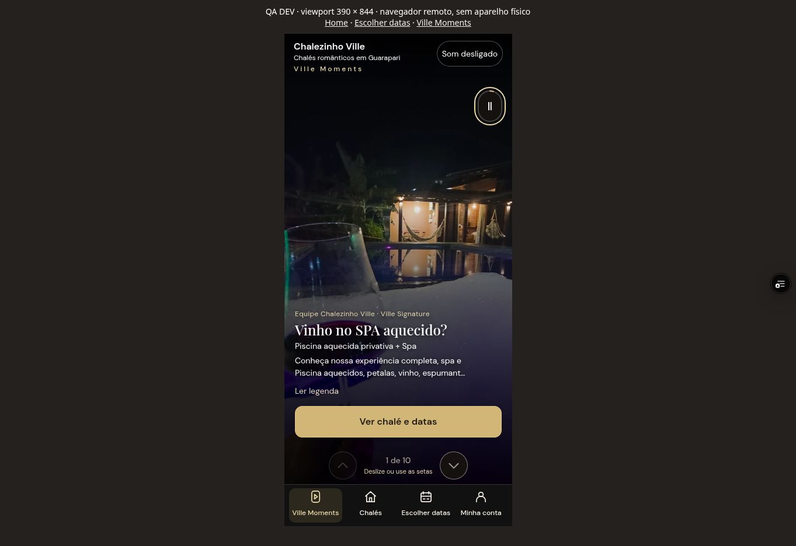

# Candidata — apresentação e consulta pelo WhatsApp

Data: 11/10/2026. **Não é autorização de publicação. Produção não foi alterada.**

## Base e ambientes conferidos antes das alterações

Repositório `roldnei/chalezinho-ville`. Base mais recente: `feature/feelings-original-audio`, `a33c8beecf28a1b45f220644b1aabb62957d495b` (10/10). Inclui a evolução de `feature/romantic-stay-offers` e Ville Moments; `main` e `desenvolvimento` eram anteriores. Implementação isolada em `feature/staged-whatsapp-launch`, sem downgrade ou alteração dessas branches.

- DEV: `pxfqmnhqodqyaaqeyjgr`, projeto Supabase `chalezinho-ville-finance-dev`.
- PROD: `irxsaladqhbzhkoaclxy`, projeto Supabase `chalezinho-ville`.
- Vercel: projeto existente `chalezinho-ville`, `prj_qXld7h9Z3I7mV9mZKuXJ4yQ1j3dc`; equipe `team_YfhCyXyWKAtieREJ6eXj3szW`.
- Criado somente `VILLE_RELEASE_PROFILE=whatsapp` em **preview, limitado à branch candidata**. Nenhuma variável de produção foi criada, alterada ou lida em seu valor secreto. Nenhum deployment foi promovido.
- Telefone reutilizado, conferido nos links existentes e JSON-LD: `+55 93 99159-2266`.

## Mapa e implementação

| Área | Implementação e preservação | Validação desta execução |
|---|---|---|
| Home, chalés e fotos | Mesmas páginas e fotos; chamadas encaminham ao formulário existente | Navegador remoto, home → Signature → disponibilidade |
| Vitrine/escapadas | Motor de merchandising existente; preços com data de consulta, inclusões e contexto transportado | API real e navegador; detalhes abaixo |
| Busca/calendários | PriceLabs e fontes iCal existentes, reservas reais, modificações pendentes e bloqueios operacionais | Consultas reais; ocupado em 09–11/11, disponível em 01–03/12 |
| Cotação | Mesmo `createQuote`, `persist=false` no endpoint público; nenhuma fórmula comercial duplicada no navegador | Cotação real `quote_id=null`; testes de regra/composição |
| Tarifa/experiências | Escolha explícita da tarifa, somente hospedagem acessível, ofertas e complementos recalculados no servidor | Tarifas reembolsável/não reembolsável, pacote romântico e café adicional |
| Resumo/WhatsApp | Resumo único gera texto exibido e mensagem; hóspedes, noites, datas, composição, desconto, total e condições; reconsulta antes de abrir | Comparação literal DOM/mensagem; nenhuma mensagem enviada |
| Retomada | Salva somente escolhas da consulta; nova consulta após reload; invalida preços antigos | Navegador e testes JSDOM; pagamentos antigos usam armazenamento separado |
| Ville Moments | Reprodução, legendas, fotos, publicações e navegação inferior preservadas, inclusive abertura pela vitrine | Feed real e leitura; testes de metadados históricos |
| Feelings/comunidade | Criação Feelings, publicação de hóspedes, curtidas e comentários indisponíveis no perfil WhatsApp; leitura dos tratamentos históricos preservada | Configuração/DOM + testes; jornadas sociais não liberadas |
| Checkout completo | Perfil padrão `checkout-development` preservado; PagBank, termos, garantias, estornos, pós-reserva, editor e comunidade permanecem no código | Regressões automatizadas; nova operação autenticada completa pendente |

A seleção de tarifa fica em branco na primeira consulta. Alterações retiram o link e os valores antigos durante a atualização. Falhas não mantêm orçamento anterior como atual. Antes do WhatsApp, o servidor recalcula; mudanças exigem nova conferência. O link **Abrir WhatsApp** aparece depois da atualização, exigindo um clique explícito e evitando depender de pop-up assíncrono. Copiar oferece seleção manual quando o navegador não confirma a gravação no clipboard. Não há afirmação de mensagem enviada.

## Proteções e efeitos indiretos

`public-consultation` possui uma lista fixa de operações de leitura. Não aceita operações financeiras, holds, solicitações de chegada no mesmo dia ou administração, independentemente de `action` no corpo, URL, `persist`, `mode`, Origin ou cabeçalho de DEV. O alias interno `consult_` tem a mesma lista no `booking-engine`. Consulta e busca não persistem quotes. Eventos de confirmação/pagamento não são aceitos nesse endpoint.

Em PROD, o projeto identificado pelo `SUPABASE_URL` é a autoridade: operações diretas de novos pagamentos são bloqueadas mesmo com cabeçalhos DEV falsificados. As exceções preparadas são consulta, exportação de calendário e operações essenciais do PMS autenticadas. **A implantação futura do engine precisa de revisão de compatibilidade com as funções/rotinas de reservas já existentes em PROD; não substituir indiscriminadamente o conjunto financeiro ou os agendamentos.**

A migration aditiva `20261011040000_public_consultation_guard.sql` impede INSERT de novas reservas diretas em `hold`/`pending_payment` no modo WhatsApp. Não altera reservas existentes, não intercepta UPDATE de histórico, não apaga bloqueios e não interfere em reservas importadas/manuais confirmadas. A tabela de configuração é inacessível a anon/authenticated. Aplicada somente em DEV, com `checkout-development` ao final para preservar o checkout de homologação. Teste transacional temporário de `whatsapp` rejeitou hold com `public_checkout_disabled`; rollback restaurou o modo DEV.

O engine e as rotinas de leitura podem atualizar saúde/cache de calendários e cache da vitrine; isso não é bloqueio de agenda. Nenhuma rotina financeira é acionada pela consulta. Os seis jobs DEV (expiração de pendências, finance-lifecycle, dispatcher, prazos pós-reserva, geração DEV e warmup DEV) foram conferidos ativos e não foram alterados. Public feed não gera novas publicações nem expõe submissões de hóspedes; geração/administração original permanece no DEV completo.

### Banco antes/depois das jornadas reais

| Objeto | Antes | Depois |
|---|---:|---:|
| Reservas | 30 | 30 |
| Pagamentos | 34 | 34 |
| Quotes persistidas | 346 | 346 |
| Bloqueios PMS | 2 | 2 |
| Outbox de notificações | 136 | 136 |
| Pedidos de chegada no mesmo dia | 1 | 1 |
| Ordens de experiências | 14 | 14 |
| Tarefas PMS | 30 | 30 |

Hashes dos IDs/status/datas/hold das reservas: `2b0c2acb8957c2ea5f629f2ac3691bfe`; dos IDs/status/valor de pagamentos: `8c822a3c42b9d27aff971fec77096099`. Iguais antes e depois. Não exportados dados pessoais. Tentativas financeiras reais no endpoint público retornaram 403 antes de delegar. A proteção equivalente de PROD foi executada em VM com ambiente PROD, sem acessar banco PROD; não foi implantada nem testada por requisições mutantes em PROD.

## PMS: o que foi efetivamente verificado

| Função | Evidência obtida | Pendência |
|---|---|---|
| Chalés, fotos, textos, comodidades | Admin autenticado: editor de descrição do Amore, salvar → leitura SQL → reabrir → restaurar; catálogo/fotos existentes lidos | Reordenação/upload de fotos e gravação de comodidades ainda sem reteste real |
| Limpeza, regras e calendários | Multicalendário e calendário individual carregados no PMS; regras 1 noite geral/2 com sexta ou sábado e consulta real coerentes; limpeza R$290 na cotação | Edição de regras/fontes e gravação de limpeza não executadas |
| Experiências, inclusões, desconto e capacidade | Admin salvou café de 100 para 101 centavos; variante e cotação real atualizaram; restaurados 100 centavos. Inclusões/fotos/eligibilidade lidas; capacidade/antecedência em testes automatizados | Novos cadastros e catálogo comercial definitivo; operação de capacidade em sessões reais |
| Escapadas | Admin pausou Escapada a dois; catálogo público deixou de incluí-la. Reativou e SQL confirmou active/5%; cadastro e prévia validaram inclusões | Criar nova oferta e homologar condições comerciais finais |
| Conteúdo/vitrine | Feed real e editor/admin_list/relatório carregados com administrador; publicações preservadas | Salvar/editar conteúdo e aprovação/moderação ainda sem operação real nesta execução |
| Permissões | Visitante redirecionado para login; administrador autenticado conseguiu salvar. RLS ativada e INSERT anon/authenticated negado nos cadastros/reservas; RPCs de reserva sem EXEC público | Sessões reais de equipe/proprietário e matriz completa de escopo |
| Publicações de hóspedes/moderação | Código preservado; não liberado no lançamento parcial | Homologação social independente |

Nenhum administrador foi criado ou recebeu privilégios adicionais. Sessão administrativa DEV foi disponibilizada pelo formulário seguro e verificada na Central. Descrição de chalé, gravação de preço de experiência e pausa/reativação de oferta foram homologadas com dados de teste reais do DEV; isso não homologa todo o PMS. Não foram criadas reservas fictícias para representar interesse ou WhatsApp.

## Evidências e limites

Checks: sintaxe, TypeScript, build do perfil WhatsApp e suíte Node: 442 aprovados, zero falhas. Após ajuste do limite de datas ao máximo existente de 1125 noites, 16 testes afetados repetidos passaram; sem limite comercial novo de 90 noites. Testes específicos incluem allowlist, tentativa de PROD com cabeçalho DEV, trava SQL em PGlite, seleção explícita, correspondência literal resumo/mensagem, mudança de preço, falha removendo orçamento e retomada somente de escolhas. JSDOM e VM são **fixtures**, não interface real.

Interface real: Chrome remoto sobre deployment Vercel DEV e funções Supabase DEV. Dados de PriceLabs/calendários são reais; limpeza/produtos/pacotes são o catálogo **de homologação DEV**. Layout móvel por iframe de 390×844; não houve teste em aparelho físico Android/iPhone, nem prova de abertura no aplicativo nativo WhatsApp. Nenhuma mensagem foi enviada a hóspedes.

Relatórios históricos consultados: `docs/homologation-20261007.md`, `docs/homologation-20261004.md`, `docs/weekday-storefront-development-review.md`, `docs/finance/final-review-20260929.md`, `docs/feelings-original-audio.md`. São evidência histórica, não aprovação desta candidata. PagBank/estornos/caução ainda têm pendências registradas nesses relatórios.

## Bloqueadores antes do primeiro lançamento

1. Catalogar e homologar os preços comerciais definitivos. DEV tem limpeza R$290 em todos os chalés e experiências `[DEV]` de R$1. PROD tem limpeza R$150/R$292/R$292 e também produtos de homologação ativos. A candidata filtra itens DEV/QA no perfil PROD; não inventa preços nem migra produtos de teste.
2. PROD não possui `stay_offers`, registro de fontes iCal, cache da vitrine ou tabelas Ville Moments. Revisar dependências de schema/colunas/políticas e preparar migração mínima; não executar em lote todas as migrations financeiras/cron de DEV. Consultas falham com segurança enquanto faltarem dependências.
3. Completar a matriz PMS: fotos/comodidades, edição de calendário/limpeza/regras, criação de cadastros, conteúdo e sessões de equipe/proprietário. Texto de chalé, preço de experiência e pausa/reativação de oferta já passaram com restauração dos valores originais. Homologar novamente checkout PagBank no perfil DEV completo.
4. Completar teste de aplicativo WhatsApp em aparelhos físicos, clipboard e acessibilidade móvel. Falhas de calendário/preço foram cobertas por fixtures e tratamento de servidor; indisponibilidade real de serviços externos não foi forçada.
5. Revisar migração das mídias/publicações comerciais aprovadas, políticas e configuração de capacidade/antecedência. Não copiar hóspedes/histórico financeiro de DEV nem eliminar conteúdo antigo.

## Publicação futura e rollback — somente após autorização

1. Revisar diff desta branch e aprovar catálogo, conteúdo, ambiente e matriz de homologação. Registrar backup/versionamento de funções e banco antes de qualquer PROD.
2. Revisar separadamente as dependências: calendários (`20260930032730`, `20261001122020`); documentos (`20261005173351`); ofertas/capacidade/vitrine (`20261005201531`, `20261005203843`, `20261005224854`, `20261006010356`); Ville Moments (`20261005235333`, `20261006170228`, `20261007033341`). Essas são referências para revisão, **não uma ordem autorizada de execução**. Não levar seeds/warmups, agenda de geração DEV, produtos QA ou ativação social automaticamente.
3. Aplicar somente migrations revisadas e aditivas; conferir RLS, permissões de equipe e índices. Aplicar launch guard com modo `whatsapp` antes de expor o site. Conferir importação/exportação de calendário e operações existentes sem desativar jobs legítimos.
4. Publicar somente funções aprovadas para PROD (`public-consultation`, engine com proteção e compatibilidade revisada, feed/admin de conteúdo), preservar webhooks/financeiro existentes. Revalidar tentativa direta de pagamento e consulta sem efeitos.
5. Configurar variáveis de produção: `VILLE_RELEASE_PROFILE=whatsapp`, `VILLE_PRODUCTION_RELEASE=approved`, `VILLE_PUBLIC_SUPABASE_URL=https://irxsaladqhbzhkoaclxy.supabase.co`, **somente chave publicável/anon** em `VILLE_PUBLIC_SUPABASE_KEY`. Build recusa perfil/ambiente desconhecido, alvo trocado e segredo de servidor. Esta execução não configurou essas variáveis.
6. Gerar candidata de produção sem promoção automática, conferir dados reais e autorização final; depois publicar. Registrar deployment anterior e versões de funções para rollback.
7. Retorno: restaurar deployment Vercel anterior revisado e versões anteriores de funções compatíveis. Manter trava WhatsApp até decisão explícita; rollback não pode liberar checkout não aprovado. Deixar migrations aditivas e histórico intactos. Verificar reservas, calendário, notificações e atendimento após o retorno. Não apagar dados para desfazer a versão.

Uma única base continua oferecendo `checkout-development` em DEV e `whatsapp` na candidata. Publicação continua pendente e precisa de autorização posterior sobre o resultado testado.

## Registro adicional das jornadas reais

- Desktop: home → Signature → datas ocupadas; novas datas → escolher estadia → tarifa explícita → resumo → link WhatsApp. Café adicional e pacote romântico recalcularam no servidor. Trocar pacote retirou valores durante carregamento.
- Vitrine → Assistir no Ville Moments: foto/publicação real, legenda e navegação inferior com Ville Moments/Chalés/Escolher datas/Minha conta. Oferta Essenza 03–05/11 transportou chalé, datas, hóspedes e escapada; não escolheu silenciosamente a tarifa recebida na URL. Total/mensagem literalmente iguais.
- Layout móvel 390×844: vídeo real Signature, legenda e navegação; Ville Moments → datas 01–03/12 → 1 hóspede/Descanso → Amore → reembolsável → resumo e copiar. Preço real consultado R$1490 com limpeza DEV R$290; mensagem refletiu 1 hóspede. Clipboard confirmado pela API do próprio navegador; fallback manual adicional validado em fixture.
- API real: 3 hóspedes rejeitados por capacidade nos 3 chalés; 04–05/12 rejeitado por minimum_stay=2; 09–11/11 ocupado nos 3. Requisições de preço/financeiro maliciosas não produziram writes. Falhas externas de preço/calendário e mudança de orçamento têm evidência automatizada, não uma interrupção forçada de PriceLabs/iCal.
- Novo clique de abertura do WhatsApp não pôde ser concluído pelo navegador remoto devido à proteção de observação de credenciais após login; nenhuma mensagem foi enviada. Link oficial, conteúdo e alternativa de cópia conferidos. Abertura do app nativo permanece teste em aparelho físico.
- Calendário PMS mostrou reservas/importações existentes, sem inclusão de bloqueios. Cadastros testados restaurados: Amore com descrição original, café/variante 100 centavos, escapada active/500 bps. Auditoria administrativa registra esses saves; nenhum histórico foi apagado.

As exceções de PROD foram revistas para que leituras públicas requisitadas pelo PMS usem sempre o caminho sem persistência; `stay_offer_action` permite somente a administração autenticada no projeto conhecido. Financeiro novo continua bloqueado por referência de projeto, não por parâmetro do navegador. Nada disso foi implantado em PROD.

### Evidência visual e estado de produção

Último deployment de produção READY conferido (somente leitura): `dpl_GfCE3VYLNmxwSorGBUPYQjU6ys41`, commit `9bc9e0e7d3b9d18bb643e724f999ff37f64bc2fc`. Há uma tentativa histórica posterior em ERROR; não usar esse ERROR como alvo de rollback. Antes de publicar, registrar novamente o deployment que efetivamente serve os aliases de produção. Schema PROD continua na migration `20260929010445` nesta conferência, sem a nova trava.

Catálogo público PROD também filtra títulos de publicações e vínculos com produtos/ofertas DEV, QA, Teste ou homologação. Administradores continuam vendo o catálogo completo para manutenção. Não apaga registros nem tratamentos.

PROD recusa publicação de hóspedes, curtidas, comentários, follows, moderação social e geração automática por visitante mesmo com cabeçalho DEV/sessão de hóspede simulados. Um pedido de `feed` em PROD é convertido em `public_feed`, sem geração e sem submissões de hóspedes. Esses casos são testes de VM; não houve implantação ou escrita em PROD.

Versões homologadas somente em DEV: `booking-engine` 62, `public-consultation` 2 e `villegram-content` 24. Log da suíte: [tests-20261011.tap](tests-20261011.tap).
